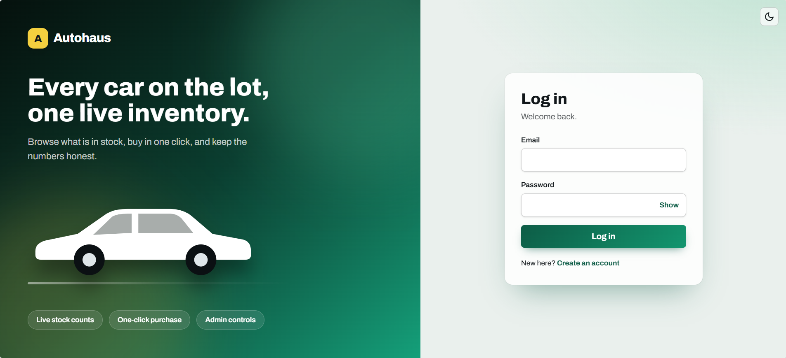
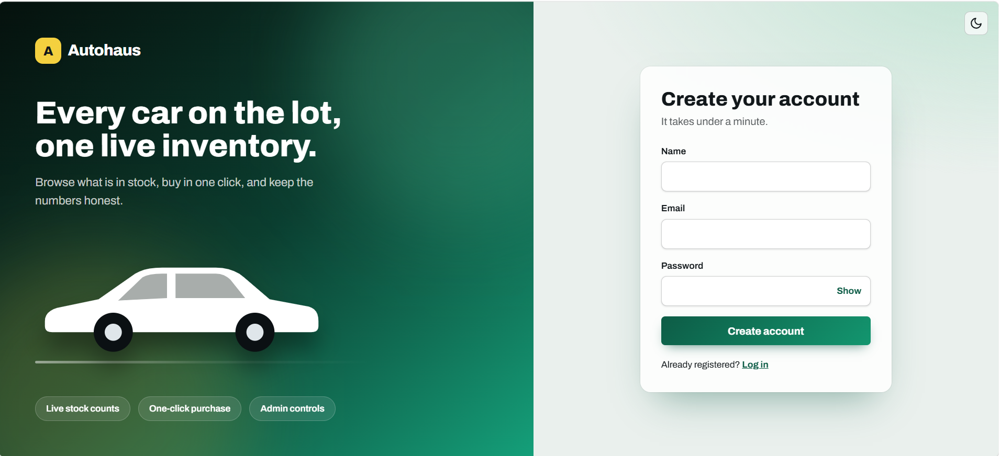
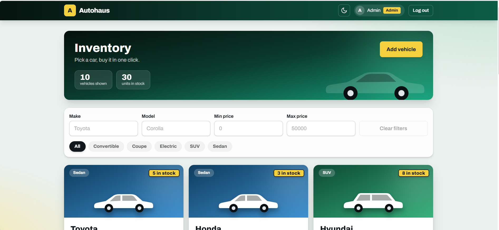
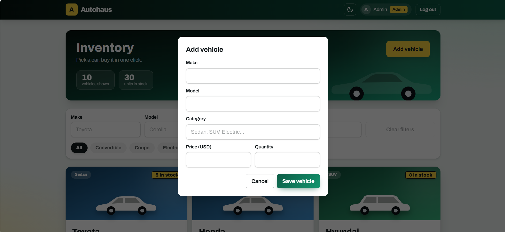
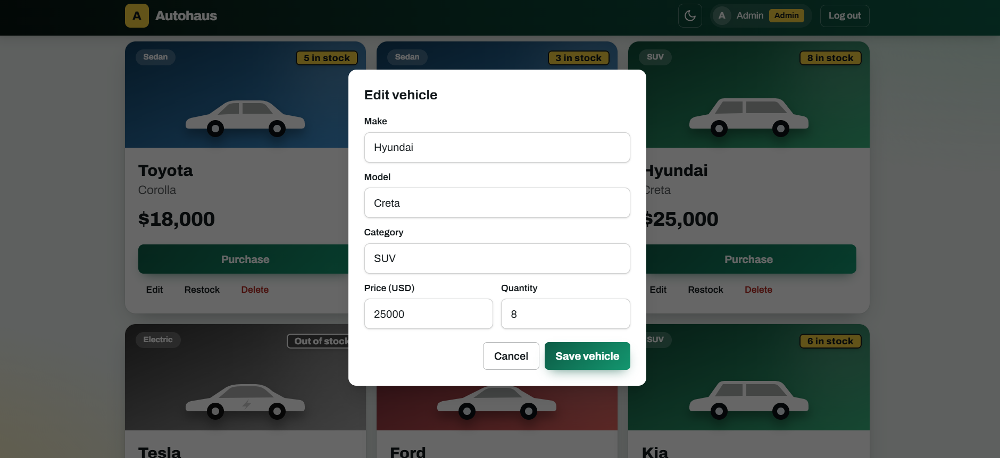
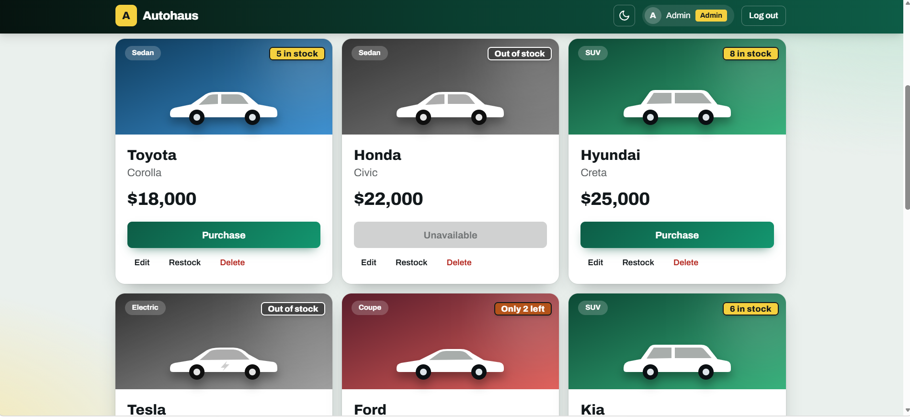
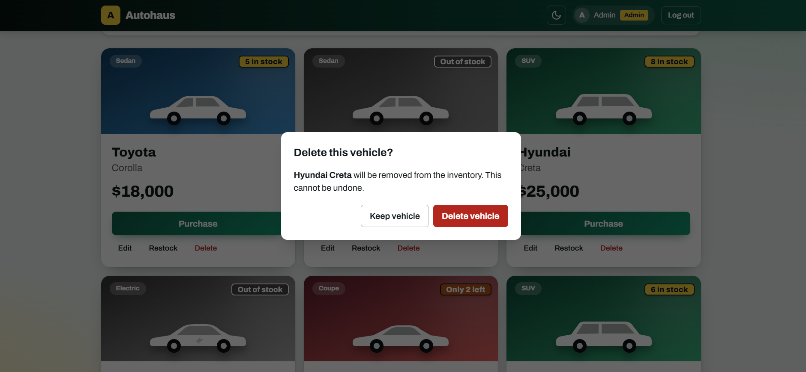

# Autohaus: Car Dealership Inventory System

A full-stack inventory app for a car dealership, built as a TDD kata. Customers register, log in, browse and search the inventory, and buy vehicles. Admins add, edit, delete and restock vehicles.

- **Backend:** REST API in Node.js, TypeScript and Express, backed by PostgreSQL, secured with JWT.
- **Frontend:** React single-page app styled with Tailwind CSS.
- **Tests:** 85 automated tests (Vitest and Supertest) running against a real PostgreSQL test database, including a concurrency test that proves the stock can never be oversold.

## Table of contents
1. [Features](#features)
2. [Tech stack](#tech-stack)
3. [Architecture and design decisions](#architecture-and-design-decisions)
4. [Project structure](#project-structure)
5. [Getting started](#getting-started)
6. [API reference](#api-reference)
7. [Testing and TDD](#testing-and-tdd)
8. [Test report](#test-report)
9. [Screenshots](#screenshots)
10. [My AI Usage](#my-ai-usage)
11. [Known limitations and future work](#known-limitations-and-future-work)

## Features
**Everyone (after login)**
- Register and log in (JWT, 1 hour sessions); a 401 anywhere logs you out with a "session expired" message
- Browse all vehicles in a responsive card grid, with live "in stock / only N left / out of stock" tags
- Search by make and model, filter by category (clickable chips) and by price range
- Purchase a vehicle: stock drops by one immediately; the button is disabled at zero stock
- Light and dark mode, remembered between visits
- Log out with a confirmation dialog
- API only for now: view one vehicle (`GET /api/vehicles/:id`) and your own purchase history (`GET /api/purchases/mine`)

**Admins only** (enforced by the API, not just hidden in the UI)
- Add, edit and delete vehicles (delete asks for confirmation)
- Restock a vehicle by any positive amount

## Tech stack
| Layer | Technology |
|---|---|
| Frontend | React 18, TypeScript, Vite, Tailwind CSS v4, React Router, Axios |
| Backend | Node.js, TypeScript, Express 5, zod (validation), bcryptjs, jsonwebtoken |
| Database | PostgreSQL via `pg` (plain parameterised SQL) |
| Testing | Vitest, Supertest, `@vitest/coverage-v8` |

## Architecture and design decisions
The backend is layered: **routes → services → repositories**, with middleware for authentication, authorization and error handling.

- `routes` parse and validate requests (zod) and shape responses.
- `services` hold business rules (for example "out of stock means 409").
- `repositories` are the only place that talks to PostgreSQL.

Decisions worth knowing about:
- **Atomic purchases.** The stock check and decrement are one conditional statement, `UPDATE vehicles SET quantity = quantity - 1 WHERE id = $1 AND quantity > 0`, inside a transaction together with the purchase record. A database `CHECK (quantity >= 0)` is a second safety net. A test fires 10 simultaneous purchases at a vehicle with 3 in stock and asserts exactly 3 succeed. Another test checks the stock decrement is rolled back if recording the purchase fails.
- **Roles.** Public registration always creates a `USER`; any `role` sent by the client is ignored. Admins come from the seed script.
- **Admin-only writes.** `DELETE` and restock are admin-only as the brief requires. I also restricted `POST` and `PUT /api/vehicles` to admins (stricter than the brief) to match the requirement of admin forms for adding and updating.
- **`GET /api/vehicles` returns out-of-stock vehicles too**, because the UI must show them with a disabled Purchase button.
- **Purchase history.** A `purchases` table records who bought what and at what price, and `GET /api/purchases/mine` lists the caller's purchases, newest first. If a vehicle is later deleted, the purchase row is kept (its vehicle link is cleared).
- **Money.** Prices are `NUMERIC(12,2)` in the database and returned as numbers by the API.
- **No user enumeration.** Login returns the same 401 message for an unknown email and a wrong password.
- **Token storage trade-off.** The JWT is kept in `localStorage` for simplicity, which is exposed to XSS. A production app should prefer an HTTP-only, secure cookie with CSRF protection.
- **Plain SQL instead of an ORM.** The project started with Prisma; I switched to `pg` so the stock logic is a single explicit, explainable SQL statement.

## Project structure
```
car-dealership/
├── backend/
│   ├── sql/schema.sql                 # idempotent schema (users, vehicles, purchases)
│   └── src/
│       ├── app.ts, server.ts
│       ├── config/env.ts
│       ├── db/                        # pool, migrate, seed
│       ├── middleware/                # authenticate, authorizeAdmin, errorHandler
│       ├── modules/
│       │   ├── auth/                  # routes, service, repository, schemas
│       │   ├── vehicles/              # routes, service, repository, schemas
│       │   └── purchases/             # routes, service, repository
│       └── tests/                     # *.test.ts, helpers, setup
├── frontend/
│   └── src/
│       ├── api.ts, types.ts
│       ├── context/                   # AuthContext, ToastContext
│       ├── components/                # VehicleCard, SearchFilters, Navbar, modals, ...
│       └── pages/                     # Login, Register, Dashboard
├── screenshots/
├── test-reports/
├── PROMPTS.md
└── README.md
```

## Getting started

### Prerequisites
- Node.js 20 or newer
- PostgreSQL 14 or newer, running locally
- Git

### 1. Clone
```bash
git clone https://github.com/YOUR_USERNAME/car-dealership-inventory.git
cd car-dealership-inventory
```

### 2. Create the databases
In `psql` or pgAdmin:
```sql
CREATE DATABASE car_dealership;
CREATE DATABASE car_dealership_test;
```
The test database name **must end in `_test`**: the tests wipe every table, and refuse to run against any other name.

### 3. Backend
```bash
cd backend
npm install
```
Create the two env files from the examples (Windows `cmd`: use `copy`; macOS/Linux: `cp`):
```bash
cp .env.example .env
cp .env.test.example .env.test
```
Edit them:
- `.env`: set `DATABASE_URL` (your Postgres user/password, database `car_dealership`) and a long random `JWT_SECRET`. Generate one with:
  `node -e "console.log(require('crypto').randomBytes(48).toString('hex'))"`
- `.env.test`: same user/password, database `car_dealership_test`.

If your password contains symbols such as `@` or `#`, URL-encode them in the connection string (`@` becomes `%40`).

Create the tables, add demo data and start the API:
```bash
npm run migrate
npm run seed
npm run dev        # http://localhost:5000
```
Check it: open http://localhost:5000/api/health, which should show `{"status":"ok"}`.

### 4. Frontend
In a second terminal:
```bash
cd frontend
npm install
cp .env.example .env     # optional: sets VITE_API_URL (defaults to http://localhost:5000/api)
npm run dev              # http://localhost:5173
```

### Demo accounts (created by `npm run seed`)
| Role | Email | Password |
|---|---|---|
| Admin | `admin@dealership.com` | `Admin@12345` |
| User | `user@dealership.com` | `User@12345` |

These are local development credentials only. Change `ADMIN_EMAIL` and `ADMIN_PASSWORD` in `.env` before seeding anything shared.

### Scripts
| Where | Command | What it does |
|---|---|---|
| backend | `npm run dev` | start the API with auto-reload |
| backend | `npm run migrate` | apply `sql/schema.sql` (safe to repeat) |
| backend | `npm run seed` | create admin, demo user and 10 sample vehicles |
| backend | `npm test` | run the test suite |
| backend | `npm run coverage` | run tests with a coverage report |
| backend | `npm run typecheck` | TypeScript check |
| frontend | `npm run dev` | start the Vite dev server |
| frontend | `npm run build` | type-check and build for production |

## API reference
All `/api/vehicles` and `/api/purchases` routes need the header `Authorization: Bearer <token>`.

| Method | Endpoint | Access | Description |
|---|---|---|---|
| POST | `/api/auth/register` | public | Create a USER account |
| POST | `/api/auth/login` | public | Returns `{ token, user }` |
| GET | `/api/vehicles` | any user | List all vehicles |
| GET | `/api/vehicles/search` | any user | Query: `make`, `model`, `category`, `minPrice`, `maxPrice` |
| GET | `/api/vehicles/:id` | any user | Get one vehicle |
| POST | `/api/vehicles` | admin | Add a vehicle |
| PUT | `/api/vehicles/:id` | admin | Update any subset of fields |
| DELETE | `/api/vehicles/:id` | admin | Delete a vehicle (204) |
| POST | `/api/vehicles/:id/purchase` | any user | Buy one unit; returns `{ vehicle, purchase }` |
| POST | `/api/vehicles/:id/restock` | admin | Body `{ "amount": 5 }` |
| GET | `/api/purchases/mine` | any user | My purchases, newest first |
| GET | `/api/health` | public | Liveness check |

A vehicle is `{ id, make, model, category, price, quantity, createdAt, updatedAt }`.

**Status codes:** `400` validation error, `401` missing/invalid/expired token or bad login, `403` not an admin, `404` not found, `409` duplicate email or out of stock. Errors look like `{ "error": "Validation failed", "details": [{ "field": "price", "message": "..." }] }`.

**Example (bash):**
```bash
# log in
curl -s -X POST http://localhost:5000/api/auth/login \
  -H "Content-Type: application/json" \
  -d '{"email":"user@dealership.com","password":"User@12345"}'

# search SUVs under 30000
curl -s "http://localhost:5000/api/vehicles/search?category=suv&maxPrice=30000" \
  -H "Authorization: Bearer <token>"

# buy vehicle 1
curl -s -X POST http://localhost:5000/api/vehicles/1/purchase \
  -H "Authorization: Bearer <token>"
```

## Testing and TDD
The repository starts with a baseline commit holding the first working version of the app and its test suite, written with Claude's help, so that early work is not red-green. After that, two backend features were built test-first: `GET /api/vehicles/:id` and `GET /api/purchases/mine`. In the git history each is a `test:` commit whose new tests fail, followed by a `feat:` commit that makes them pass, and a `refactor:` commit where I cleaned up (a repeated line, and a file-name typo). Two extra tests for existing behaviour (purchase history after a delete, and rollback on failure) pass immediately, so they are not red steps.

- Tests call the real Express app through Supertest and a real PostgreSQL test database. Every test starts from empty tables.
- Covered: validation, hashing, JWT (missing, malformed, expired, forged, wrong role), admin authorization, search filters (including `%` treated literally), stock handling, purchase records, restock rules, concurrent purchases and purchase history.

Run them:
```bash
cd backend
npm test            # run the suite
npm run coverage    # with coverage
```

## Test report
Full output of `npm run coverage`: [`test-reports/backend-coverage.txt`](test-reports/backend-coverage.txt). A readable summary is in [`test-reports/TEST_REPORT.md`](test-reports/TEST_REPORT.md).

| Metric | Result |
|---|---|
| Test files | 6 passed, 0 failed |
| Tests | 85 passed, 0 failed, 0 skipped |
| Statements | 98.02% |
| Branches | 90.24% |
| Functions | 100% |
| Lines | 98.83% |
| Duration | TODO-FILL (the same number as in the test report) |

| Test file | Tests | Covers |
|---|---|---|
| `auth.test.ts` | 18 | registration, password hashing, login, health, 404 |
| `middleware.test.ts` | 8 | token checks, admin authorization |
| `vehicles.test.ts` | 25 | add, list, get one, update, delete and their validation |
| `search.test.ts` | 13 | every filter, combinations, bad input |
| `inventory.test.ts` | 17 | purchase, restock, concurrency, rollback, purchase history |
| `purchases.test.ts` | 4 | my purchases: auth, empty list, isolation and ordering, deleted vehicle |

## Screenshots

### Login


### Register


### Inventory dashboard


### Add vehicle (admin)


### Edit vehicle (admin)


### Out-of-stock vehicles
Out-of-stock cars are greyed out with a disabled Purchase button.



### Delete confirmation (admin)


## My AI Usage
The full chat history is linked in [PROMPTS.md](PROMPTS.md).

### Which AI tools I used
I used **Claude** (Anthropic, through claude.ai) for this project. [EDIT: add any other tool you really used, such as Copilot or ChatGPT, or delete this note.]

### How I used it
- **Planning.** I pasted the kata brief and asked Claude for a step-by-step plan. We agreed on the stack (Node, TypeScript, Express, PostgreSQL, React, Tailwind, Vitest) and the order of work.
- **Backend code and tests.** Claude generated the first version of the API (auth, vehicles, search, purchase, restock), the SQL schema, the seed script and the test suite. I ran everything on my own machine with a local PostgreSQL install. Later, Claude drafted the tests for two extra endpoints, which I committed and ran before writing the code.
- **Design choices it proposed.** Atomic stock updates, a purchase-history table, ignoring any `role` sent at registration, and a concurrency test. [EDIT: say which of these you understood and agreed with, and why.]
- **Frontend.** Claude built the React and Tailwind screens, the card design with car illustrations, search chips, dark mode and the logout confirmation. I tested them in the browser and asked for changes when something looked wrong (for example the banner overlapping a button, and browser password pop-ups on the login form).
- **Debugging.** I pasted terminal errors and screenshots into the chat. Examples: a leftover Prisma `.env`, a missing `.env.test` that Vitest hid behind a confusing startup error, and database password setup on Windows.
- **Git history.** I had Claude help me plan the commit sequence and write the commit messages. Every AI-assisted commit has a `Co-authored-by` trailer.

### How I handled TDD with AI
The first version of the app and its tests was drafted together with Claude and committed as a baseline, so that early history is not red-green. After that I added two backend features test-first: I had Claude draft the failing tests, ran them to watch them fail, committed them, then wrote the minimum code to pass and refactored. [EDIT: say how much you wrote or changed yourself, and what you learned.]

### What I checked, changed or rejected
- [EDIT: for example, "I read each test and the SQL for the purchase query, and can explain why `WHERE quantity > 0` prevents overselling."]
- [EDIT: for example, "We dropped Prisma for plain `pg` because ..."]
- [EDIT: anything you changed in the generated code or the UI, and why.]

### Reflection
- **What AI did well:** it removed a lot of boilerplate, suggested edge cases I might not have thought of (concurrent purchases, role escalation at registration, SQL wildcard characters in search) and sped up the UI work considerably.
- **Where it needed correction:** [EDIT: your real examples, such as setup steps that did not match my machine, or something I had to debug myself].
- **What I learned:** [EDIT: for example JWT authentication flow, atomic SQL updates, how the red-green-refactor loop works, writing integration tests with Supertest].
- **Limits I noticed:** AI output can look confident and still be wrong, so I ran every test and every screen myself instead of trusting it. I can walk through any file in this repository.

## Known limitations and future work
- No pagination on the vehicle list
- JWT in `localStorage`; no refresh tokens (HTTP-only cookies would be safer)
- No rate limiting on login
- Purchases are one unit at a time; there is no cart or checkout
- `GET /api/vehicles/:id` and `GET /api/purchases/mine` are not used by the frontend yet
- No frontend automated tests
- No CI pipeline and no live deployment yet
